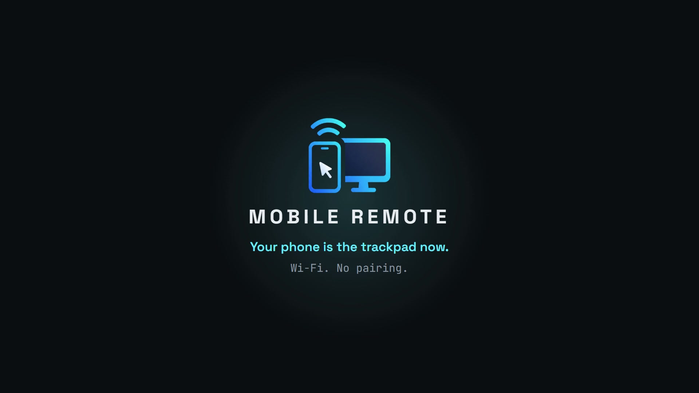

<div align="center">


# Mobile Remote

**Your phone is the trackpad now.**

Trackpad, keyboard, media keys, app launcher, clipboard sync, file transfer,
a virtual gamepad and a live view of your desktop — over plain Wi‑Fi.
No Bluetooth pairing, no cloud, no account.


<a href="brag-output/brag.mp4"></a>

<sub><b><a href="brag-output/brag.mp4">▶ Watch the 20-second tour</a></b></sub>

</div>

---

## Why this exists

A Bluetooth keyboard app kept dropping mid-use — connected, reconnecting, dead,
repeat. Bluetooth HID on Android is genuinely fragile: Windows powers down idle
HID devices, only one app may own the HID profile, and OEMs kill the background
service. So this goes over Wi‑Fi instead, with a small helper on the PC. It has
been rock solid since, and it kept growing until the phone could drive the whole
desktop.

## What you get

| | |
|---|---|
| 🖱️ **Trackpad** | Multi-touch with pointer acceleration — tap, right-click, middle-click, scroll, drag |
| ⌨️ **Keyboard** | Live typing field, shortcut strip, sticky CTRL/ALT/SHIFT/SUPER, voice dictation |
| 🎵 **Media** | Play/pause/next, the PC's **real volume** as a slider, and what's currently playing |
| 🚀 **Apps** | Launch anything installed on the PC, run key-combo macros, lock/sleep/shutdown |
| 🖥️ **Live view** | Your desktop streamed to the phone — finger is the pointer, rotate for fullscreen |
| 📋 **Clipboard** | Two-way text sync between phone and PC |
| 📁 **Files** | Send photos, videos and files to the PC, with progress |
| 📲 **Share sheet** | Share a link or file from *any* Android app straight to the PC |
| 🎮 **Gamepad** | Landscape controller — a real virtual Xbox pad, or keyboard mapping for emulators |
| 🔌 **Wake-on-LAN** | Wake a sleeping PC from the connect screen |

Everything runs on your LAN. Nothing leaves your network.

## Quick start

```bash
# 1. On the PC
cd server && pip install -r requirements.txt && python server.py

# 2. On the phone — install the APK, open Mobile Remote

# 3. Tap your PC in the list, type the PIN the server printed. Done.
```

Full detail below.

---

# 1 · Set up the PC

The server is a single Python program. It prints a **PIN**, listens on
TCP **48889**, and answers discovery broadcasts on UDP **48888**.

```bash
cd server
pip install -r requirements.txt
python server.py
```

On first run it writes `config.json` next to the script and prints something like:

```
====================================================
  Mobile Remote server v1.2.0
  Name     : STUDIO-PC
  PIN      : 4821   (change it in config.json)
  IPs      : 192.168.1.24
  MAC      : 7c:10:c9:a0:3f:63
  Port     : 48889
  Desktop  : windows  (input: pynput, capture: mss)
  Features : apps, system, clipboard, files, screen, wol, lock_state, volume, now_playing, gamepad, gamepad_xbox
  Files to : C:\Users\you\Downloads\Mobile Remote
====================================================
```

It then minimises to a **tray icon**. Right-click it for connection info, the
received-files folder, and (packaged build) a *Start with Windows* toggle.

### config.json

| Key | Default | What it does |
|---|---|---|
| `pin` | random 4 digits | What the phone must enter. Change it to anything you like. |
| `port` | `48889` | TCP port the app connects to. |
| `name` | your hostname | The name shown in the app's PC list. |
| `downloads` | `~/Downloads/Mobile Remote` | Where files sent from the phone land. |

Edit it and restart the server. When packaged as an `.exe`, the file lives in
`%APPDATA%\Mobile Remote\config.json` instead.

### Firewall

The first run usually pops a Windows Firewall prompt — **allow it on private
networks**. If you dismissed it, the phone will never find the PC. To fix it
later, run once as administrator:

```powershell
New-NetFirewallRule -DisplayName "Mobile Remote" -Direction Inbound -Action Allow -Protocol TCP -LocalPort 48889
New-NetFirewallRule -DisplayName "Mobile Remote discovery" -Direction Inbound -Action Allow -Protocol UDP -LocalPort 48888
```

### Windows

Double-click **`run_server.bat`** — it locates a working Python, installs the
dependencies on first run, then starts the server. Or use the packaged
**`MobileRemote.exe`** (no Python needed; tray icon, *Start with Windows*).

Everything works out of the box except the virtual Xbox gamepad, which needs a
driver:

- **[ViGEmBus](https://github.com/nefarius/ViGEmBus/releases)** — install it if
  you want XBOX mode in the Gamepad screen. Without it the app falls back to
  KEYS mode automatically and tells you why.

Build the `.exe` yourself:

```bat
cd server
pip install pyinstaller -r requirements.txt
build_exe.bat
```

> **Smart App Control.** On a fresh Windows 11 install, Smart App Control blocks
> unsigned executables — including a self-built `MobileRemote.exe`. Either run
> `run_server.bat` instead (Python itself is signed), code-sign the exe, or turn
> Smart App Control off. Most machines have it off already.

### macOS

```bash
cd server
pip3 install -r requirements.txt
python3 server.py
```

macOS will ask for two permissions the first time:

- **Accessibility** — required, this is how input is injected.
- **Screen Recording** — only needed for the Screen tab's live view.

Grant them in *System Settings → Privacy & Security*, then restart the server.

Volume control works via `osascript`. Now-playing is not available on macOS;
the media row falls back to plain media keys.

### Linux — Hyprland / Omarchy / Sway / GNOME / KDE

On Wayland, the usual input libraries can't inject events, so the server creates
a **virtual keyboard and mouse through `/dev/uinput`**. That works on every
compositor. One-time setup:

```bash
# Arch / Omarchy — screen preview, clipboard, now-playing
sudo pacman -S grim wl-clipboard playerctl

# allow /dev/uinput, then log out and back in
sudo usermod -aG input $USER

cd server
pip install -r requirements.txt     # pulls python-evdev on Linux
python server.py
```

Debian/Ubuntu equivalents: `sudo apt install grim wl-clipboard playerctl`
(on GNOME/KDE Wayland `grim` may not work — see troubleshooting).

Optional: **`wtype`** lets the typing field send non-ASCII characters.

The server detects Hyprland and reports it to the app, which then:

- labels the modifier key **SUPER** instead of WIN, everywhere
- seeds the Apps tab with Omarchy's own bindings — Super+Return terminal,
  Super+Space launcher, Super+Alt+Space menu, Super+W close, Super+1/2 workspaces

Edit those in the app to match your actual config; it stops re-seeding once you do.

X11 sessions work too and use the regular backends (`pynput` + `mss`).

---

# 2 · Install the phone app

Android **7.0+** (minSdk 24). Grab a prebuilt APK from
[Releases](../../releases), or build it:

```bash
cd app
flutter pub get
flutter build apk --release --split-per-abi
adb install -r build/app/outputs/flutter-apk/app-arm64-v8a-release.apk
```

| Build | Size |
|---|---|
| `app-arm64-v8a-release.apk` — almost every modern phone | **16.8 MB** |
| `app-armeabi-v7a-release.apk` — older 32-bit devices | 14.1 MB |
| `app-release.apk` — universal, all ABIs | 50.0 MB |

Android will warn about installing outside the Play Store; allow it for your
browser or file manager.

---

# 3 · Connect

1. Start the server on the PC.
2. Open **Mobile Remote**. It scans the network and lists any PC it finds.
3. Tap your PC, type the 4-digit **PIN** from the server window, hit **Connect**.

The app remembers the PC, so after the first time it's just open-and-go.

**No PC in the list?** Some routers block UDP broadcast (common on guest networks
and mesh systems). Tap **Enter an address manually** and type the IP the server
printed.

**No Wi-Fi network?** Turn on the phone's hotspot and connect the PC to it. Works
identically — the phone becomes the router.

---

# Using it

## Tabs

| Tab | What it does |
|---|---|
| **Pad** | Trackpad, mouse buttons, shortcut keys, media controls with the PC's real volume slider and now-playing line |
| **Keys** | The same pad, plus a live typing field (text reaches the PC as you type) and a 🎤 button for dictation |
| **Apps** | Lock / Sleep / Power, launch tiles for apps installed on the PC, and editable macros |
| **Screen** | Live view of the desktop — finger drives the pointer. Rotate the phone for immersive fullscreen |
| **Share** | PC ↔ phone clipboard, send text, send photos and files |
| 🎮 **Gamepad** | Header button — landscape virtual controller |

## Trackpad gestures

| Gesture | Action |
|---|---|
| 1 finger move | Move the pointer (with acceleration) |
| 1 finger tap | Left click |
| 2 finger tap | Right click |
| 3 finger tap | Middle click |
| 2 finger drag | Scroll |
| Hold still ~0.35 s, then move | **Drag** — the border lights up |
| Hold the **LEFT** button | Mouse button stays down; drag with another finger |

## Live view gestures

The Screen tab is *direct touch* — your finger is the pointer, not a relative pad.

| Gesture | Action |
|---|---|
| 1 finger drag | Pointer follows your finger |
| Tap | Click there |
| Double tap | Double click |
| Hold still, then move | Drag — move windows, select text |
| 2 finger tap | Right click there |
| 2 finger drag | Scroll |
| **Rotate the phone** | Immersive landscape fullscreen; rotate back to exit |

Quality presets (Smooth / Balanced / Sharp) trade frame rate for resolution.
A monitor picker appears if the PC has more than one display.

## Sticky modifiers

The **CTRL / ALT / SHIFT / SUPER** row above the key strip latches. Turn on
SUPER, type `w` → the PC receives Super+W. The latch clears after one key, so
you can fire compositor bindings without a physical keyboard.

The label follows the PC: **WIN** on Windows, **CMD** on macOS, **SUPER** on Linux.

## Android share sheet

Share a link, text, photo, video or any file from any app and pick
**Mobile Remote**:

- **text and links** → land in the PC's clipboard, ready to paste
- **files** → saved to `Downloads/Mobile Remote` on the PC, with a progress card

If the app isn't connected it reconnects to your last PC by itself first.

## Voice typing

On the **Keys** tab, tap 🎤 and talk. Each phrase is typed on the PC as it's
recognised, with a live preview above the field. Tap again to stop. Needs
microphone permission and Android's speech recogniser (the Google app).

## Gamepad

The 🎮 header button opens a landscape controller: two analog sticks (tap to
click them), d-pad, A/B/X/Y, LB/RB, analog LT/RT (press then slide down to
feather), Back and Start.

| Mode | What the PC sees |
|---|---|
| **XBOX** | A real virtual Xbox 360 controller. Windows needs [ViGEmBus](https://github.com/nefarius/ViGEmBus/releases); Linux uses uinput, no driver needed |
| **KEYS** | Buttons mapped to keyboard keys — arrows, `Z X A S`, `Q W E R`, Enter, Backspace — for emulators that only take a keyboard |

All buttons release automatically when you leave the screen.

## Settings

The ⚙ button holds pointer speed (0.5–10×), scroll speed, a media-keys toggle,
vibration feedback, and disconnect.

---

# Troubleshooting

<details>
<summary><b>The phone can't find my PC</b></summary>

In order of likelihood:

1. **Firewall.** The most common cause. See [Firewall](#firewall) above.
2. **Different networks.** Phones often sit on a 5 GHz SSID or a guest VLAN that
   can't reach the PC. Check both are on the same network, or use the phone's
   hotspot.
3. **Broadcast blocked.** Guest networks and some mesh routers drop UDP
   broadcast. Use **Enter an address manually** with the IP the server printed.
4. **AP isolation / client isolation.** Some routers block device-to-device
   traffic entirely. Turn it off, or use the hotspot.

To prove the server is reachable, from any machine on the LAN:

```bash
# should connect, not time out
python -c "import socket; socket.create_connection(('192.168.1.24', 48889), 3); print('reachable')"
```

</details>

<details>
<summary><b>"Python was not found; run without arguments to install from the Microsoft Store"</b></summary>

Windows ships a 0-byte stub at `%LOCALAPPDATA%\Microsoft\WindowsApps\python.exe`
(an *App execution alias*). When it sits before your real Python in `PATH`,
typing `python` hits the stub, which prints that message and exits with code
9009 — even though Python is installed.

`run_server.bat` works around it by executing each candidate before accepting
it, so it should just work. To fix it system-wide so plain `python` works in any
terminal, either:

- **Settings → Apps → Advanced app settings → App execution aliases** → switch
  off `python.exe` and `python3.exe`, or
- move your real Python folder above `…\Microsoft\WindowsApps` in the user
  `PATH` (*Settings → System → About → Advanced system settings → Environment
  Variables*).

</details>

<details>
<summary><b>"wrong pin"</b></summary>

The PIN is regenerated only on first run — after that it's whatever is in
`config.json`. Read it from the server window, the tray icon's *Connection
info…*, or the file itself. Set it to something memorable and restart the server.

</details>

<details>
<summary><b>"PC is locked" — nothing responds</b></summary>

Expected, and not fixable from the app. Windows, macOS and Linux all block
injected input on the lock screen (that's what the "secure desktop" is for), so
no userspace program can type your password for you. The app detects it and says
so rather than failing silently. Unlock at the PC.

A PC that is **asleep** is different — if Wake-on-LAN is enabled in its BIOS and
network adapter settings, the connect screen offers a **WAKE** button for any PC
you've connected to before.

</details>

<details>
<summary><b>Screen preview says it's unavailable</b></summary>

- **Windows / macOS / X11** — install the capture deps: `pip install mss Pillow`.
  On macOS also grant *Screen Recording*.
- **Wayland** — install `grim` (`sudo pacman -S grim` / `sudo apt install grim`).
  `grim` works on wlroots compositors (Hyprland, Sway, river). GNOME and KDE
  Wayland use different portals and aren't supported yet — everything except the
  Screen tab still works.

</details>

<details>
<summary><b>Gamepad falls back to KEYS mode</b></summary>

XBOX mode needs a virtual-controller driver:

- **Windows** — install [ViGEmBus](https://github.com/nefarius/ViGEmBus/releases)
  and restart the server.
- **Linux** — needs `python-evdev` and write access to `/dev/uinput`
  (`sudo usermod -aG input $USER`, then log out and back in).

The app shows the actual reason under the mode toggle.

</details>

<details>
<summary><b>Linux: nothing moves, or "uinput is not writable"</b></summary>

The server needs permission to create a virtual input device:

```bash
sudo usermod -aG input $USER
# log out and back in, then confirm:
id -nG | grep input
ls -l /dev/uinput
```

If the device is missing entirely, load the module:

```bash
sudo modprobe uinput
echo uinput | sudo tee /etc/modules-load.d/uinput.conf   # persist across reboots
```

The server prints a `NOTE:` line at startup explaining exactly which backend it
ended up with and why.

</details>

<details>
<summary><b>Typing is laggy, or the pointer stutters</b></summary>

Check the latency readout under the PC name in the header. Under ~30 ms is
healthy on Wi-Fi.

- 5 GHz beats 2.4 GHz by a lot for this.
- The Screen tab is the only bandwidth-heavy feature — leave the tab to stop it.
- Lower the quality preset (Smooth) if the live view is the bottleneck.

</details>

---

# Performance & battery

The release APK is **16.8 MB** for arm64, of which ~11 MB is the Flutter engine
itself. Built with R8 shrinking, resource shrinking and obfuscation:

```bash
flutter build apk --release --split-per-abi --obfuscate --split-debug-info=build/symbols
```

Battery-wise, the app is close to free when idle and only costs while you use it:

- trackpad moves are batched to **≤1 packet per 8 ms**
- pings and the screen stream **pause when the app is backgrounded**
- the live stream opens only while the Screen tab is on-screen, and closes when
  you leave
- the network is only scanned on the connect screen, never in a loop

---

# Building from source

### Server

```bash
cd server
pip install -r requirements.txt
python server.py
```

Package a standalone Windows executable (no Python on the target machine):

```bat
cd server
pip install pyinstaller -r requirements.txt
build_exe.bat          :: → dist\MobileRemote.exe
```

### App

```bash
cd app
flutter pub get
flutter analyze
flutter build apk --release --split-per-abi
```

Requires the Flutter SDK (Dart ≥ 3.13) and the Android SDK with compileSdk 37.

### CI

[`.github/workflows/build.yml`](.github/workflows/build.yml) builds the Windows
`.exe` and the APKs on every push, and attaches them to a GitHub Release when you
push a `v*` tag:

```bash
git tag v1.0.0 && git push origin v1.0.0
```

---

# How it works

```
┌─────────────────┐                             ┌──────────────────┐
│  Android app    │   UDP 48888  discovery      │  server.py       │
│  (Flutter)      │ ──────────────────────────► │  (tray app)      │
│                 │ ◄────────────────────────── │                  │
│  touch, keys,   │   "PCREMOTE_HERE_V1|…"      │  input backend   │
│  gamepad state  │                             │   · pynput       │
│                 │   TCP 48889  JSON lines     │   · uinput       │
│                 │ ◄─────────────────────────► │  capture backend │
│  live view ◄────┼───  TCP 48889  JPEG frames  │   · mss / grim   │
└─────────────────┘        (second socket)      └──────────────────┘
```

The server picks its backends at startup based on the desktop it finds, and
reports the result to the app in the handshake — which is how the app knows to
say SUPER instead of WIN, hide the Screen tab's controls when capture is
unavailable, or offer XBOX gamepad mode.

| Layer | Windows | macOS | Linux/X11 | Linux/Wayland |
|---|---|---|---|---|
| Input | pynput | pynput | pynput | **uinput** virtual device |
| Capture | mss | mss | mss | **grim** |
| Clipboard | pyperclip | pyperclip | pyperclip | wl-clipboard |
| Volume | pycaw | osascript | wpctl / pactl / amixer | wpctl / pactl / amixer |
| Now playing | WinRT media session | — | playerctl | playerctl |
| Gamepad | ViGEm | — | uinput | uinput |

Source map:

- [`server/server.py`](server/server.py) — protocol, discovery, tray, file transfer
- [`server/inputs.py`](server/inputs.py) — input backends
- [`server/capture.py`](server/capture.py) — screen capture backends
- [`server/media.py`](server/media.py) — volume and now-playing
- [`server/gamepad.py`](server/gamepad.py) — virtual controller
- [`app/lib/remote_client.dart`](app/lib/remote_client.dart) — the client, reconnect, request/response
- [`app/lib/ui/`](app/lib/ui/) — one file per screen

---

# Protocol

<details>
<summary><b>Full message reference</b></summary>

Newline-delimited JSON over TCP. The first message must be a hello:

```jsonc
// →
{"t":"hello","pin":"1234","name":"phone"}
// ←
{"t":"ok","name":"STUDIO-PC","features":["apps","system","clipboard","files","screen",…],
 "os":"windows|macos|hyprland|linux-wayland|linux-x11","mac":"7c:10:…","locked":false}
```

Any message may carry an `"id"`; the reply echoes it back so the client can match
request to response.

| Message | Meaning |
|---|---|
| `{"t":"mv","dx":5,"dy":-3}` | Relative pointer move |
| `{"t":"mv_abs","x":0.5,"y":0.5,"mon":1}` | Move to a fraction of a monitor |
| `{"t":"click","b":"left","n":1}` | Click (`left` / `right` / `middle`) |
| `{"t":"click_at","x":0.5,"y":0.5,"mon":1,"n":1}` | Click at a fraction of a monitor |
| `{"t":"down","b":"left"}` / `{"t":"up","b":"left"}` | Press / release — used for dragging |
| `{"t":"scroll","dx":0,"dy":-1}` | Wheel |
| `{"t":"text","s":"hello"}` | Type a string |
| `{"t":"key","k":"enter","mods":["ctrl"]}` | Key press with modifiers |
| `{"t":"key_down","k":"shift"}` / `key_up` | Hold / release a key |
| `{"t":"apps"}` | → `{"apps":[{"name","path"}]}` |
| `{"t":"launch","path":"…"}` | Open an app |
| `{"t":"system","action":"lock"}` | `lock` / `sleep` / `shutdown` / `restart` |
| `{"t":"monitors"}` | → monitor list with sizes and offsets |
| `{"t":"clip_get"}` / `{"t":"clip_set","s":"…"}` | Clipboard |
| `{"t":"file_begin","name","size"}` | → `{"token"}`, then `file_chunk` (base64 `d`), then `file_end` |
| `{"t":"volume_get"}` / `{"t":"volume_set","v":40}` / `{"t":"mute_set","m":true}` | Master volume |
| `{"t":"media_info"}` | → `{"media":{"title","artist","playing","app"},"vol","muted"}` |
| `{"t":"pad_mode","mode":"xbox"}` | Then `{"t":"pad","b":<bitmask>,"lx","ly","rx","ry","lt","rt"}` |
| `{"t":"ping"}` | → `{"t":"pong","locked":false}` |

**Gamepad button bits**, in order:
`a b x y lb rb back start ls rs du dd dl dr guide`

**Screen stream.** Open a *second* connection whose hello carries
`"mode":"stream"` plus `fps`, `w`, `q`, `mon`. After the `ok` line the server
pushes JPEG frames as `<4-byte big-endian length><bytes>`. Send
`{"t":"stream_stop"}` to end it.

**Key names.** Single characters, or:
`enter backspace tab esc space delete insert home end pageup pagedown up down
left right shift ctrl alt win capslock printscreen f1`…`f12 play_pause next
prev vol_up vol_down mute`

**Discovery.** Broadcast `PCREMOTE_DISCOVER_V1` to UDP 48888; servers reply
`PCREMOTE_HERE_V1|<name>|<port>|<mac>`.

</details>

---

# Project layout

```
server/            Python helper that runs on the PC
  server.py          protocol, discovery, tray, files
  inputs.py          input backends (pynput / uinput)
  capture.py         screen capture (mss / grim)
  media.py           volume + now playing
  gamepad.py         virtual controller
  MobileRemote.spec  PyInstaller build
app/               Flutter Android app
  lib/               client, settings, UI (one file per screen)
design/            UI design sources (Claude Design canvas)
brag-output/       the launch film + its HyperFrames composition
.github/workflows/ CI: builds the exe and APKs, cuts releases on v* tags
```

**Branches** — `main` (releases) · `develop` (active work) ·
`prototype_1` (the frozen first prototype, kept for reference)

---

# Credits

- Launch film built with [HyperFrames](https://hyperframes.heygen.com/) via the
  [`/brag`](https://github.com/latent-spaces/brag) skill. Music, SFX and font
  attribution: [`brag-output/composition/assets/CREDITS.md`](brag-output/composition/assets/CREDITS.md)
- Fonts: [Space Grotesk](https://github.com/floriankarsten/space-grotesk) and
  [JetBrains Mono](https://github.com/JetBrains/JetBrainsMono), both OFL
- Virtual Xbox controller on Windows via
  [ViGEmBus](https://github.com/nefarius/ViGEmBus) / `vgamepad`

## License

No license file yet — by default that means **all rights reserved**, and others
can't legally reuse the code. If you want people to use it, add one (MIT is the
usual choice for a project like this).
